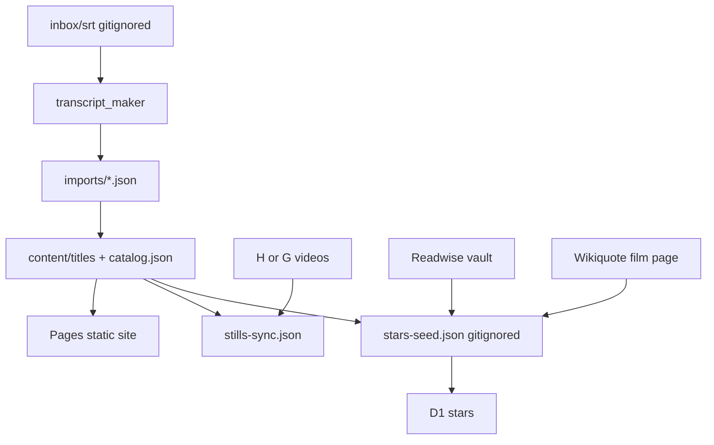

# Content ingest

Run this whole pipeline in one go unless the user asks to stop after a step.

## Procedure

1. **Detect new files.** List `inbox/srt/` (and named subfolders like `Simpsons_S5`). `batch:export` is **not recursive**. Compare filenames/titles to `content/catalog.json`. Skip anything already imported. Never re-import titles in `content/stars-protected.json`.

2. **Clean names.** Copy new files to a temp dir with titles like `Barbie.2023.eng.srt`. Release-group names leak into catalog titles.

3. **Convert** from sibling `../transcript_maker`:
   ```bash
   npm run batch:export -- <dir> --out ../textline-nextline/imports
   ```
   Skip tracks that are clearly incomplete (≲500 cues or starting ~20min in). `.sub` is supported.

4. **Import each NEW json only** (never `import:all` — that remaps `lineIndex` and breaks stars):
   ```bash
   npm run import -- imports/Barbie-2023.json
   ```

5. **Sync the movie clock** for each new movie that has a file on disk. This is the stills offset, not a D1 write. TV episodes stay in Catalog Ops → Stills ([stills-extract](../stills-extract/SKILL.md)). Do not `--playable` and do not R2.

   1. Match `content/titles/{id}.json` to `H:\videos\movies\`, then `G:\videos\movies\`. Trust the filename.
   2. Probe fps and duration against the last line's `startMs`. A 23.976 fps file that runs about as long as the subtitle is offset 0, `timeScale` 1. PAL `0.96` is for a ~25 fps rip whose picture runs short. The studio suggests PAL when late dialogue frames look wrong; on a 24 fps file that scale lands the ending a few minutes early. Do not record `0.96` until a late lock confirms it.
   3. Pick three cues whose picture can only be one moment: a title card, a named prop, a place, or a sound that is the picture. Ordinary dialogue is often the other person in the shot. A sound cue can also be a cross-cut; if the next line names the room on screen, the clock is right.
   4. Extract beside the studio folder so a handful already on screen is left alone:
      ```bash
      npm run content:stills -- --title TITLE_ID --indices 40,533,932 --offset-ms 0 --time-scale 1 --no-skip-existing --out inbox/stills-preview/_check
      ```
   5. Look at the JPEGs. The same slip on every lock is an `offsetMs`. Early locks right and late locks on the credits is the cue to try `0.96` on one late lock before recording it.
   6. Record `content/stills-sync.json`: `offsetMs`, `timeScale`, `fps`, `durationSec`, `source`, and a `note` that names the locks. Set `syncedAt` only when every lock is the right picture. Leave `syncedAt` off when one is wrong — the row stays **review** and waits. Delete `inbox/stills-preview/_check`. A synced row may be batched (`npm run content:stills:overnight` on this PC, or Batch remaining lines). Do not R2 from ingest. If the Stills tab is open, the user should refresh before the next extract. An open tab can write `timeScale: 0.96` back, and a batch uses the file.

6. **Match Readwise** (vault is local; TV matches catalog episode names, not just Letterboxd):
   ```bash
   npm run content:queue -- --from inbox/letterboxd --vault "C:\Users\dasco\Documents\clocs\Readwise"
   ```

7. **Wikiquote.** For a catalog movie that is not in `stars-protected.json` and has fewer than 5 live stars for `dascolin@gmail.com`, fetch the English film page and union it into the seed. For The Simpsons, SpongeBob SquarePants, and It's Always Sunny, fetch each season page and match episode headings onto the catalog episodes we have (SpongeBob segments on one file share that file). Vault (and any earlier seed line) keeps the line when both sources hit the same `lineIndex`. Other titles already in `stars-seed.json` stay. Protected titles are skipped.
   ```bash
   npm run content:wikiquote -- --title the-big-lebowski-1998 --vault "C:\Users\dasco\Documents\clocs\Readwise"
   ```
   Then preview a merge push for that title only. `--merge` inserts missing lines and leaves existing rows (including loved). It does not delete. Protected titles are still skipped.
   ```bash
   npm run content:stars-push -- --email dascolin@gmail.com --title the-big-lebowski-1998 --merge --remote --dry-run
   ```
   **Stop.** Show how many lines would be inserted. Wait for the user to confirm, then drop `--dry-run`. New rows with note `wikiquote` insert into `quotes` (`origin = wikiquote`), not `stars`. A line that was already starred stays a star (`ON CONFLICT DO NOTHING`). A vault line on the same cue stays a star. After they finish removing quote-mark misses, add that title id to `stars-protected.json`. A later `--merge` would put removed lines back, because a deleted row is not a conflict.

8. **Protect curated stars, then push** for `dascolin@gmail.com`. Never `--force`.
   1. Query prod D1 star counts vs `content/stars-seed.json`.
   2. Add every title where live ≠ seed to `content/stars-protected.json` (and `DEFAULT_PROTECTED_TITLE_IDS`).
   3. Dry-run:
      ```bash
      npm run content:stars-push -- --email dascolin@gmail.com --remote --dry-run
      ```
   4. **Stop.** Show skip vs insert. Wait for the user to confirm.
   5. Then write (no `--force`):
      ```bash
      npm run content:stars-push -- --email dascolin@gmail.com --remote
      ```
   Skips protected ids even with `--force`. Also skips any title that already has live stars. Current lock: Wolf, Empire, Ocean's 13, Payback, Inglourious, Batman Begins, Django, The Gentlemen.

9. **Report.** New title ids, cue counts, Readwise hits, Wikiquote matches, the stills clock for each new movie (offset, scale, and the locks), D1 skip vs insert, and that **Pages deploy** is still required for new movies to appear on the site. Transcripts live in git; D1 is stars only. Wikiquote stars are that email’s rows, so they show up in their Curate. Stills stay local until a later thumbs-up and R2 push.

## Where things live



| Store | What goes live |
| --- | --- |
| `content/titles` + `catalog.json` | Playable lines. Commit + Pages deploy. |
| `content/stills-sync.json` | Per-title offset and scale. Commit. JPEGs stay in `inbox/stills-preview/`. |
| `content/stars-protected.json` | Title ids seed-push must never touch. |
| D1 `stars` | `(title_id, line_index, player_id)` after `stars-push --remote`. |
| Pages | UI + baked catalog. New titles invisible until deploy. |

## Follow-up

Protected titles skip the **whole film** so Curate unstars stay gone. Later: tombstones on unstar, then merge `seed − tombstones`.

**Next time:** `@` this file. Add “just stars” (step 8 only: protect + dry-run + wait), “wikiquote” (step 7 for one title), “sync” (step 5 for one movie), or “full ingest” (steps 1–9). Phrases like `content ingest` / `stars-push` still auto-match if you do not `@` it. A whole TV series (Sunny, Simpsons dump, “add show”) is [add-show](../add-show/SKILL.md).
