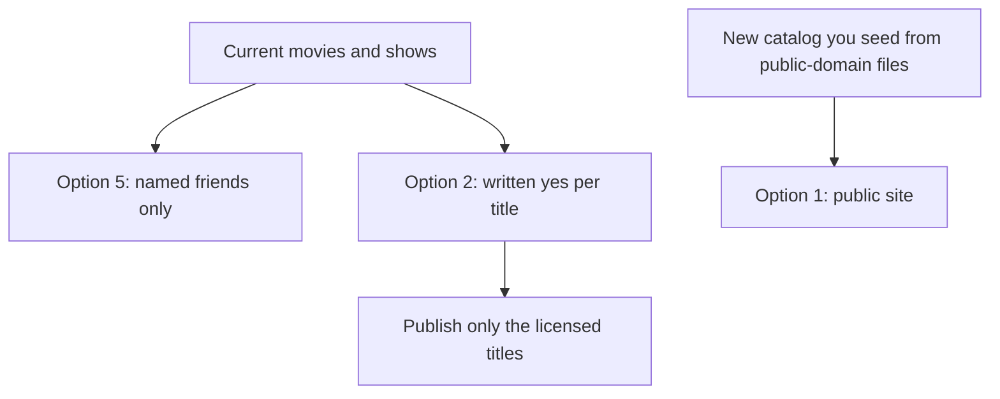

# Copyright, profit, and ads

Saved from the October 2026 copyright review. Paths forward for a seeded game added November 2026.

This is general information about US copyright, not legal advice. An IP lawyer should review anything you plan to charge for, open to the public, or run ads on. Copyright is territorial, so a US-only theory does not clear the same catalog in the EU or elsewhere.

## Where this stands

Options 3 and 4 stay set aside. The game only works if the transcripts are already seeded.

The fear matches the catalog. Simpsons, Sunny, and the studio films are already on a public Pages site, with the transcripts bundled into the build. A wider launch of that catalog — ads on the site, or a campaign that sends strangers to it — is the step to hold.

- **Option 5** keeps this game. The full private version (an allow-list, stills behind auth, no public share cards) is written below. That shrink is available. It is not the current plan.
- **Option 1** is how a public push becomes possible later. You still seed full transcripts. The shelf changes to files you can clear. Early films will not feel like the current queue.
- **Option 2** is a letter, not a launch. TMDB licenses their posters and metadata, not dialogue. A studio will not grant a full-transcript game of these series through a web form. The probe that might get a yes is one independent filmmaker or writer who still controls the work. Silence is not a license. Publish only the titles the paper covers.

You can move forward without taking the site down and without a second deploy. On that choice, forward means the one site stays up, people you know can still have the link, and a cleared shelf starts growing on the same catalog. Ads and a marketing push still wait until the public build is cleared titles only, or a written license covers every title on it. A second site, or taking modern titles out of the build, is the gate in front of that later work. It is optional until you want that work.

Working order: [Practical order](#practical-order). The same order is on the [roadmap](ROADMAP.md#rights).

## What this app actually publishes

Textline is a next-line game over **full timed transcripts** in [content/titles](../content/titles), built from subtitle files, plus **frames pulled from local movie files** and served from R2 at `/stills/`. Posters sit at `/posters/`. Wikiquote is only a match needle for which lines to star ([src/lib/content/wikiquote.ts](../src/lib/content/wikiquote.ts)); the stored text is still the subtitle line.

That is the legally relevant product: the dialogue of commercial films and shows, in order, with pictures from the picture.

The live site is a public Cloudflare Pages deploy ([DEPLOY.md](DEPLOY.md)). Episodes are bundled into the static build. A login wall on the UI does not unpublish those files, the `/stills/` URLs, share links, quote cards, or daily mail.

## Profit is a multiplier, not the switch

Publishing is the act that matters. A public free site that walks players through an entire subtitle file is already a reproduction and public distribution of copyrighted expression. Ads, subscriptions, affiliates, and sponsorships then do three things:

- They make the use commercial, which weighs against fair use.
- They make you easier to notice and more worth a demand letter.
- Statutory damages do not require you to have turned a profit. Willful commercial use is the worse end of that scale.

Downloading the films and subtitle files is its own problem, separate from the website. Subtitle files are copyrighted (the transcription and, for translations, a derivative work). Ripping a disc or stream can also raise anti-circumvention issues even when you already paid for a copy. Personal possession is not the same thing as publishing the transcript and frames.

## Why fair use is a weak fit here

Fair use is a defense you raise after a claim, not a permission. Courts look at purpose, the kind of work, how much you took, and market effect.

- Films and episodes are core creative works.
- The game uses the lines in sequence, including ordinary dialogue, not a short excerpt for criticism.
- A full transcript can substitute for a script or a subtitle track.
- The closest precedent is hostile to this shape of product. In *Castle Rock v. Carol Publishing* (2d Cir. 1998), the Seinfeld Aptitude Test lost: a commercial quiz built by mining a show’s dialogue was not fair use. A Harry Potter companion that copied too much expression lost on the same idea (*Warner Bros. v. RDR Books*, 2008). A single short line inside a larger original work can go the other way; an entire playable transcript does not look like that case.

Wikiquote stays up because it is a nonprofit, it caps quotes, it refuses to become a substitute for the work, and it has a foundation behind the takedown process. Their CC BY-SA license covers the page’s editorial text. It does not give you the studio’s dialogue, and it does not cover frames you cut from a download.

## How Letterboxd and IMDb do it

They sell attention around the films. They do not republish the films’ dialogue or consumer-ripped frames.

**Letterboxd** is member reviews, ratings, lists, and diaries. Film metadata, synopses, trailers, and poster art come from [TMDB](https://letterboxd.com/about/film-data/). They make money from Pro and Patron subscriptions (Pro removes third-party ads) and from programmatic plus direct ads, including studio campaigns sold through partners like Playwire. Patron poster-picking is explicitly “from the options on TMDB,” which is a licensed metadata relationship, not a rip of the movie.

**IMDb** (Amazon) runs ads and IMDbPro. Quotes there are short user submissions, moderated, and not full scripts. Photos are licensed to IMDb for IMDb’s own use; [IMDb’s own help page](https://help.imdb.com/article/imdb/general-information/can-i-use-a-photo-from-your-site-for-my-web-site-or-publication/G7V6PHXKDLLK7AS6) says they cannot sublicense those stills, posters, or videos to you. Publicity stills and posters are supplied under studio and photo-agency deals. IMDb also tells contributors not to upload images they do not have rights to.

Lyrics sites are the nearer analogy for “the words are the product.” Genius and Musixmatch pay publishers. They do not rely on fair use for a complete lyric library.

TMDB’s own [API terms](https://www.themoviedb.org/api-terms-of-use) treat ads and subscriptions as commercial use. Their commercial plan is on the order of $149/month under $1M revenue, and it covers **their** metadata and images. It does not license screenplays, subtitles, or frames from the movie.

Titles and facts (year, director, that a film exists) are generally usable to identify a work. Exact dialogue, subtitle timing, and frames are not in that bucket. Logos and key art are also trademark and copyright material. Using a title to say which film you mean is the narrow, safer piece.

## Options, from cleanest to grayest

The game only works if transcripts are already there, so the two “someone else fills it in” shapes (incidental quotation, and a user-submitted site you do not seed) are set aside below. What remains are three paths that keep a seeded catalog.

1. **Public-domain and freely licensed catalog only.** In the US, works published in 1930 or earlier are generally public domain as of 2026 (1931 arrives in 2027). Some later films are public domain because of a missed notice or a missed renewal. You can run ads on a game built only from those transcripts and frames. Check each title: a later restoration, score, or translation can still be copyrighted, and the same film can still be protected in the EU. This is the path that actually supports AdSense-style monetization.
2. **License the words and images.** Realistic small-app license: TMDB’s commercial API for posters, cast, and descriptions, with attribution. Unrealistic for this catalog: studio-by-studio licenses for full dialogue and frame grabs. Buying a DVD or a published screenplay does not include a right to put the text and frames on a public site.
3. **Change the product until the copyrighted material is incidental.** Original prompts you write, paraphrased trivia, or a few short quotes inside real commentary is the review/Wikiquote shape. It can still be challenged, especially with ads, and *Castle Rock* is the case a studio would cite against a quiz. It is a different risk profile from serving every line of a current show. **Set aside:** the game does not take off unless the transcripts are already seeded.
4. **A real user-submitted site, with you not seeding it.** DMCA safe harbor can protect a host for what users upload if you register an agent, respond to takedowns, and do not induce infringement. It does not cover transcripts and stills you ingested yourself. **Set aside** for the same reason: an empty catalog does not become this game.
5. **Keep the current catalog private and noncommercial.** That lowers the chance of a fight. It does not create a right to publish, and it does not become acceptable once ads go on.

There is no clever structure (ads on a movie blog, a “fan” label, nonprofit wrapping a full transcript, attribution, or “we don’t host the video”) that clears full modern transcripts plus ripped frames.

## Which step is the public one

The fear matches the analysis. Widening who can reach the catalog you have now — Simpsons, Sunny, studio films — is the move to hold. A step toward “more people can play” still exists on each of the three paths. They publicize different things.

- **Option 5** publicizes an invitation. The movies stay the ones you love. The audience stays people you name.
- **Option 1** publicizes a site. You still seed full transcripts. The movies change to ones you can actually clear.
- **Option 2** publicizes nothing until a written yes. For the current studio catalog, that yes is unlikely, slow, and expensive. It is a letter, not a launch plan.

The current plan keeps one domain. A page that also contains the modern transcripts is still the modern catalog, whatever else sits next to it. That is acceptable while the site stays free and unadvertised. It stops being acceptable when ads or a campaign go on that same page. The split is the later gate, written in the [practical order](#practical-order).

## Option 5 — private, noncommercial, current catalog

Available, not the current plan. The current plan leaves the public site up. This section is the shrink, if we later choose it.

This is the path that keeps the game you already built and makes the audience smaller. “A step forward” here means more friends playing, with the public surface getting smaller rather than larger. No ads, no subscription, no affiliate links, no sponsor posts. Popularity inside that circle does not graduate the catalog to public.

An unlisted URL is still public. So is a Discord of strangers, a quote card on social media, and a Google sign-in that anyone can complete.

### Phase 0 — See what is already on the internet

Before inviting anyone new, list the live surfaces:

- `https://textlinenextline.com`, `www`, and `textline-nextline.pages.dev`
- The static build, which bundles transcripts
- `/stills/` on R2, and `/posters/`
- Share links, quote-image export, daily email
- Google OAuth, if the consent screen is published for anyone

If those are world-readable, the catalog is already published. Shrinking that surface is this option. The [practical order](#practical-order) leaves it up.

### Phase 1 — Name the circle

Write down who may have an account. Named people you know. You create the account, or you allow-list the address. Open signup and “anyone with the link” are the edge where this path ends.

### Phase 2 — Close the leaks

The private copy has to match the circle.

- Serve the modern transcripts and stills only to signed-in, allow-listed accounts. A UI gate in front of a public JS bundle or a public `/stills/` URL leaves the files up.
- Turn off public share links, public quote cards, and daily mail to anyone outside the circle. The email is another copy of the lines and frames.
- Keep Google’s OAuth app in testing, with those people as test users, or drop public Google sign-in.
- Do not post lines, stills, or screenshots to Reddit, Letterboxd, or anywhere indexed.

### Phase 3 — Invite

The publicizing available on this path is: “I’ll make you an account.” Play with those people. See whether the game is good. That is a real step, and it stays inside the circle you named.

### Phase 4 — Stop here until another path clears

Revisit a public launch only after an option 1 catalog exists, or a written license covers specific titles. The private catalog can keep running for friends the whole time.

## Option 1 — a public catalog you can seed

This keeps the product model: you ingest full transcripts and frames, then people play. It changes the shelf. Early and silent films, plus the occasional later film that actually lapsed, will not feel like the Simpsons queue. That is the trade for a site you can point strangers at and, later, advertise.

Treat “I read that this movie is public domain” as a lead, not a clearance. *It’s a Wonderful Life* is the cautionary example: the film’s registration lapsed, and the underlying story was used to pull it back. A blog list is not a source.

### Phase 0 — Same site is fine for the pilot

Do not take the modern catalog down to try these titles. Add them to the live catalog and tag them, so a later split is possible. One shared library does not clear the modern titles sitting beside them. Leave ads off, and do not send a campaign at the site, while both shelves share a domain.

### Phase 1 — Write a rule you can apply to every file

A title gets in only when all of these are true:

- You have a reason the **film** is public domain in the US: published in 1930 or earlier, or a documented missed notice or missed renewal that you can point at (Copyright Office records, the Stanford renewal database, Duke’s Public Domain Day lists).
- The **file you transcribe and grab frames from** is itself a public-domain scan, typically an Internet Archive file whose rights statement says so. A commercial Blu-ray of the same story can still carry a restoration, a new score, or a modern subtitle track.
- You skip new translations, new scores, and colorizations. Dialogue you transcribe yourself from that scan is the cleanest text. A subtitle file someone else timed can be a separate claim even when the spoken words are old.
- You accept that EU and other countries may still protect the same film. A public website is visible there. A lawyer should draw that line before you invite a general audience, especially if you later take payment.

### Phase 2 — Pilot five to ten titles

Run them through the pipeline you already have. Play them. The question to answer is whether next-line is fun when the lines are not quotes people already know. If it is dull, option 1 does not save this catalog. It tells you the public game needs different titles, or that the public game is not worth building.

Prefer files an archive has already marked public domain, then confirm the title. Cult titles people can name (*Night of the Living Dead*, Keaton features, *Nosferatu*, *Metropolis*) are the interesting end of the shelf, and several of them have famous restorations or new scores you should not use. Confirm the specific file.

### Phase 3 — Play the pilot on the live site

Leave it on the one domain. Skip TMDB posters for these titles until you are comfortable calling the site commercial and paying for TMDB’s commercial plan. Until then, no posters, or only images that came with the public-domain file.

A separate deploy, or a build that cannot serve a modern id, is the later gate in the [practical order](#practical-order). It is the step before ads or a campaign. It is not required to find out whether these titles are fun.

### Phase 4 — Monetize the clean site

After the public site has been public-domain-only for a while, ads or a small subscription fit this path. TMDB’s commercial API (on the order of $149/month under $1M revenue) is how you add posters and metadata legally. It still does not cover dialogue. Buying it for the current studio catalog would decorate the risky site.

### Phase 5 — Then advertise

Promotion belongs to this site only. Search and social ads on film-trivia and public-domain-film keywords. Sponsorships on movie podcasts and YouTube essay channels, with an ad read that names the game and creative that uses frames from the cleared files. A Letterboxd list of those titles. Affiliates to legal copies or to the archive once the page is not itself a copy of a protected script.

Quote cards and social posts are separate publications. Use frames from the same cleared files.

## Option 2 — license, then publish

This is the only path that puts *these* movies on a public site with permission. It is also the path least likely to produce a full-transcript game of studio films. Treat it as a probe you can run while option 5 stays the way friends play. Do not treat it as the launch timeline.

What you can license soon, and what you cannot:

- **TMDB commercial API** covers their posters, cast, and descriptions. Buy it when a cleared public site needs images. It does not unlock dialogue or your frame grabs.
- **A studio business-affairs deal** for an entire series transcript plus a frame per line is a product license. Warner, Disney, HBO, and the Simpsons rightsholders do not run a web form for that. Expect silence, a no, or a fee that makes ads irrelevant.
- **One independent rightsholder** is the experiment that might return a yes: a filmmaker who owns their film, a short released under a written license, a screenwriter who still controls the script. One yes teaches you what a usable deal looks like.
- **A DVD, a streaming login, or a published screenplay** is a copy you bought. The publisher or studio still owns the right to put the text and frames on a site.

### Phase 0 — Same freeze

Stop widening the public deploy while you ask. A letter that says “I am already serving your full transcript at this URL” is a confession. Describe the game you want to launch.

### Phase 1 — Write the ask on one page

For each title: nonexclusive license to show the dialogue in a next-line game, and whether a single frame per line is included. Territory (US or worldwide). Term. Whether ads are allowed. Credit line. What you will pay, or that you are asking for a free noncommercial grant. A vague “can I use your movie?” note gets ignored.

### Phase 2 — Send it to someone who can say yes

Start with an independent filmmaker or a writer who controls the work. One title. Keep the studio catalog out of the first email. If you later approach a studio, use a lawyer, and do not attach the corpus you already ingested.

### Phase 3 — Publish only what the paper covers

A written yes means those titles, on those terms, on the public site. Silence, a friendly “sounds cool,” and “we’ll get back to you” are not a license. A no closes that title. The private friends catalog can still contain it under option 5.

### Phase 4 — Ads only inside the license

If the grant forbids commercial use, the licensed titles stay free of ads and sponsorships. If the grant allows them, ads run on that set. Mixing in an unlicensed episode on the same site undoes the grant’s protection for the site as a whole.

## If you only monetize a cleared catalog

Buying ads is ordinary and does not fix the content. It also does not require advertising on pirate or subtitle sites. Those placements are low quality and tie the brand to infringement.

What Letterboxd-scale sites actually sell is mostly closed to a new app: studio banners and Amazon/IMDb inventory are priced and sold for film campaigns, not for indie trivia. Practical places to promote a **cleared** game:

- Search and social ads on film-trivia and public-domain-film keywords (Google, Reddit, Meta).
- Sponsorships on movie podcasts and YouTube essay channels. The ad read can name the game. The creative has to use frames you have rights to.
- Organic film communities (a Letterboxd list of the public-domain titles you support, relevant subreddits that allow self-promotion). Letterboxd is a place to be discussed, not a self-serve ad slot for a small app.
- Affiliates to legal copies (library, rental, Blu-ray, or the archive) once the page is not itself the copy of the script.

Ad creative, quote cards, and social posts are separate publications. A clean catalog with infringing promo images is still a problem.

## Practical order

One site. Do not shrink what is already public, and do not stand up a second site, unless a later gate says so.

1. **Leave the live site up.** `textlinenextline.com` stays the only catalog. People you already share the link with can keep playing. No allow-list and no second deploy.
2. **Hold the two moves that widen the risk.** No ads, subscriptions, affiliates, or sponsorships on this site. No paid promotion, podcast reads, launch posts, or public quote cards that send strangers to the modern titles. Sharing the existing link with people you know can continue.
3. **Pilot a public-domain shelf on that same site.** Write the file rule (option 1, phase 1), ingest five to ten archive titles, tag them, and play them (phases 2–3). The tag is what makes a later split possible. Playing them is how you learn whether next-line works when the lines are old. The modern titles beside them stay uncleared.
4. **Optional: one license letter.** An independent rightsholder, one title, the one-page ask (option 2, phases 1–2). Describe the game. Leave the live URL and the existing corpus out of the email. Do not wait on an answer to keep playing.
5. **Gate, only when you want ads or a public campaign.** Either the public build contains only cleared titles, or a written license covers every title on it. That is when a second site, or taking modern titles out of the build, becomes the work. Until then, product work on the one site continues.
