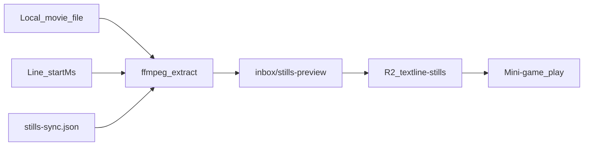

# Shipped

Archive of how we got here. Not the working plan — see [ROADMAP.md](ROADMAP.md). How to run the app: [README.md](../README.md).

Phase writeups moved here from the old README. Do not treat checklists as current work.

---

## Phase 1 — Single-player (MVP)

**Goal:** One player can search a title, play through a transcript, and get a score when they miss.

### Features

- [x] **Transcript library (seed content)**
  - Import 3–5 episodes from transcript_maker JSON exports
  - Store as versioned content (files in repo or DB seeded once)
  - Metadata: title, show/season/episode if applicable, line count

- [x] **Pick a title**
  - Browse or search the curated library (no live SRT fetch)

- [x] **Game session (single player)**
  - Show the current line
  - Present multiple choice for the **next** line (Fun mode)
  - Correct → advance to next line, repeat
  - Wrong (Fun) → try again on the same question
  - Wrong (Medium/Hard) → end run, display score

- [x] **Minimal UI**
  - Search / pick a title
  - Play screen (current line, choices, progress)
  - Game over screen (score, option to restart same title)

### Out of scope for Phase 1

- Accounts / logins
- Multiplayer
- Quote sharing (Concept 2)
- Medium/Hard free-text modes (Fun / MCQ only for Phase 1)
- Leaderboards
- Runtime subtitle search or OpenSubtitles integration

### Phase 1 success criteria

- At least a few episodes are playable from the curated library.
- User picks a title and plays through the transcript (Fun mode: until the end; Medium/Hard: until one miss).
- Score reflects how many lines they got right.
- New episodes can be added by exporting from transcript_maker and dropping into the content store.

Also in this era: stars, mini-games, Cloudflare Pages deploy (1.5); Worker + D1 star sync (1.6); Curate bulk-star UI (1.7).

---

## Phase 1.8 — Library browse UX

**Goal:** Once the catalog mixes movies and multi-season TV, a flat title list is too noisy. Browse by kind, then drill into shows.

### Features

- [x] **Episode meta on import** — parse `Show - 5x01 - Name` into `meta.show` / `season` / `episode`
- [x] **Grouped library** — Movies list + TV Shows → season → episode (`libraryGroups` + `LibraryScreen`)

Home rails (“your recent” + top played) live on the signed-in **Home** landing in [Phase 2.5](#phase-25--reputation--profile-after-2a); **Browse full library** uses this grouping.

---

## Phase 2a — Auth + share mini-game *(before rooms)*

Shipped on main (PR #5). PR #6 followed with safer per-title star push and MCQ prompt lead-in.

- [x] **Magic-link login** — email link via Resend; session on Worker + D1
- [x] **Login gate** — browse/play requires sign-in
- [x] **Editable display name** — `PATCH /api/auth/me` from the auth bar
- [x] **Claim anonymous stars** — map browser `playerId` → user on first sign-in
- [x] **Share mini-game link** — `#/play/:shareId`; recipient must sign in
- [x] **Attribution / scores** — `shared_runs` leaderboard per share

### Phase 2a.1 — Local auth polish

- [x] **Origin-aware magic links** — email link uses the request `Origin` when it is in `ALLOWED_ORIGINS` (so localhost gets a localhost link). **Redeploy the Worker** for this to apply against the production API.
- [x] **Vite-only continue** — “Continue without signing in (local only)” on the login screen in `npm run dev`

### Phase 2a.2 — Google Sign-In *(reduces magic-link friction)*

Keep the **login gate** (browse/play still require an account). Add one-click Google beside magic link (Yahoo/etc. still use email).

- [x] **GIS button + Worker ID-token verify** — Google Identity Services on the login screen; `POST /api/auth/google` verifies the JWT (aud/iss/email) and creates the same D1 session as magic link
- [x] **Config** — Worker `GOOGLE_CLIENT_ID`; `GET /api/auth/config` exposes it; optional `VITE_GOOGLE_CLIENT_ID` fallback. **You still need** a Google Cloud OAuth Web client + published consent screen for non-test users.
- [x] **Cost** — Google Sign-In is free; no per-login fee

Rooms (turn-based multiplayer) are still later — [ROADMAP.md](ROADMAP.md#rooms-phase-2).

---

## Phase 2.5 — Reputation & profile *(after 2a)*

**Goal:** Gamify without waiting on rooms or global leaderboards. Every completed run is recorded. Signed-in players get a tabbed profile (account, match history, game stats). **Home** is the landing (recent + top played); the full catalog is one click away under Browse. End-of-run thumbs collect a light quality signal for later popular-star ranking.

Auth already exists (Phase 2a). Solo `GameRun` used to be **client-only** — the only persisted scores were `shared_runs` on a share link. Crowd popular is the sum of each person’s star weight. A normal star weighs 1.

### Features

- [x] **Persist runs** — on complete (finished or miss), write a row to D1 for the signed-in user. Include full-episode and mini-game, plus shared mini-games (keep `shared_runs` for the share leaderboard; also log a personal `runs` row so history is one table).
- [x] **Profile** — auth bar name opens a profile with tabs: **Account** (display name), **Match history**, **Game stats** (games played, lines guessed, titles touched, personal most-played). Reputation is those totals — not ELO.
- [x] **Match history** — list on the profile: **game** (full vs mini, mode), **title** (movie or show + episode), **score** (`correct / questions`, plus wrongs/skips), and stored thumbs when present. Mini runs with a saved prompt list can **Share** an exact replay (`#/play/:shareId`); a short cohort line shows who played. Newest first. Personal; not a public leaderboard.
- [x] **Home + library** — signed-in landing is **Home**: **your recent**, **your top played**, then **top movies / shows · everyone** (global play counts). Crowd rails show even if you have no games yet. **Browse full library** opens Movies \| TV. Clicking a title shows who has played it most and who has the high game.
- [x] **Thumbs on complete** — optional thumbs up / down on the game-over screen (skip allowed). One rating per run, changeable until they leave. Thumbs up adds 1 to that person’s weight on each line from the game they had already starred. Thumbs down gives that point back. It does not create a new star.
- [ ] **Light weight on popular *(later slice)*** — do **not** change `/api/stars/popular` in the same ship as collecting votes. When enough ratings exist, apply a small title-level nudge (clamp about ±10%) so well-liked titles’ crowd stars surface a bit sooner. Never hide or unstar a line from a thumbs-down. Leftover: [ROADMAP.md](ROADMAP.md#later).

### Data (D1)

New `runs` table, keyed by run id (many games per user + title):

| Column | Notes |
|--------|--------|
| `id` | UUID |
| `user_id` | Signed-in player |
| `title_id` | Catalog id |
| `length` | `full` \| `mini` |
| `mode` | `fun` \| `medium` \| `hard` |
| `correct_count`, `wrong_count`, `skip_count` | Same as today’s complete screen |
| `question_total` | Denormalize so history does not need the catalog |
| `end_reason` | `finished` \| `miss` |
| `share_id` | Nullable; set when the run was (or became) a shared mini-game |
| `question_queue` | JSON array of prompt line indices for mini-games; required to share an exact replay |
| `completed_at` | ISO timestamp |

New `run_ratings` (or `thumb` on `runs`): `up` \| `down`, `rated_at`. Unique on `run_id`.

Indexes: `(user_id, completed_at DESC)` for history; `(title_id)` for top-played; optional `(user_id, title_id)` for personal bests.

**Reputation (v1):** derived, not a stored ELO. Example: rank from total `correct_count` (and maybe games finished). Enough to feel like progress; competitive ladders stay later.

**Top played:** `COUNT(*)` of runs per `title_id`, then group TV with existing show metadata (`libraryGroups`). Movies stay per title.

### Later popular formula *(not v1)*

Keep star **count** as the primary sort. Then a small multiplier from net thumbs on that title:

```
popular_score ≈ star_count × (1 + ε × title_sentiment)
```

`title_sentiment` is mean of run thumbs on that title (up = +1, down = −1), `ε ≈ 0.1`, clamp the factor to roughly `0.9–1.1`. Optional extra: slightly down-weight a player’s stars on a title they thumbs-downed. Thumbs never dominate a 3-star vs 1-star gap.

### Out of scope for 2.5

- Public / friends leaderboards
- Rooms / realtime (Phase 2)
- Changing what a **star** means
- Requiring a thumb to leave the complete screen
- Anonymous run log (play already requires sign-in)

### Done when

- Finishing (or missing out of) a solo or shared game writes a `runs` row.
- Profile shows stats + a match-history list (game, title, score, thumbs when present).
- Home lists your recent + your top played, then everyone’s top movies/shows (visible with zero personal games). Opening a title shows per-title leaders (most played / high game).
- Complete screen has optional thumbs; ratings persist. A thumbs-up adds 1 to that person’s existing star weight on each line from the game.
- Mini-game history rows with a saved prompt list can share an exact replay; Setup share still uses live stars.

### Exact replay from match history

Setup **Share mini-game** still means “play my **current** stars” (queue is rebuilt + shuffled each time). Sharing a **finished mini-game** from history freezes that run’s prompt line indices in order. Friends play the same 10 setups; MCQ distractors may still shuffle. Full-episode rows have no Share. Runs completed before queues were persisted cannot be shared exactly.

---

## Phase 2.6 — Quote stills, R2, catalog ops *(after 2.5)*

**Goal:** Mini-game prompts show a still from the moment that line is spoken — not only the one-sheet. Extract locally, eyeball a handful, then serve production frames from a private R2 bucket. The owner gets a catalog dashboard (stars, plays, still coverage, disk). Seed-push cannot overwrite stars you curated in the app.

Does **not** wait on rooms. Auth (2a) is the only gate for Catalog.

### Features

- [x] **Starred stills** — ffmpeg at line `startMs` (`× timeScale + offsetMs`). PAL 25 fps vs theatrical → `timeScale: 0.96`. Per-title sync in [`content/stills-sync.json`](../content/stills-sync.json).
- [x] **Remux** — AVI/Xvid needs generated PTS (`content:stills:remux` → gitignored `inbox/media/{titleId}.mkv`). Skip remux when the encode already matches theatrical (Wolf BluRay).
- [x] **Mini-game art** — still `/stills/{titleId}/{lineIndex}.jpg` → poster → hide. Full-episode play stays text-only.
- [x] **Dev `/stills`** — Vite serves gitignored `inbox/stills-preview/`.
- [x] **Production R2** — private bucket `textline-stills` + Pages Function [`functions/stills/`](../functions/stills/). Push with `content:stills:push`.
- [x] **Owner Catalog** — `#/ops`, visible only to `dascolin@gmail.com` (`local@dev` in Vite). Sortable columns: curated, stars, plays, still %, on-disk.
- [x] **Disk match** — `content:uploads` vs `G:\videos\movies` → [`content/uploads.md`](../content/uploads.md) + `stills-coverage.json`.
- [x] **Protect curated stars** — [`content/stars-protected.json`](../content/stars-protected.json). Seed push skips those ids even with `--force`, and skips **any** title that already has live stars unless `--force`.
- [x] **Agent skill** — [`.cursor/skills/stills-extract/SKILL.md`](../.cursor/skills/stills-extract/SKILL.md). Stop after a starred handful until the frames match.
- [x] **Catalog ingest (this branch)** — Back to the Future 1–3, Gone in 60 Seconds, Goodfellas, O Brother, 40 Year Old Virgin, Lebowski. Dune skipped (incomplete SRT).



### Status

Live D1 vs `stars-seed.json` for `dascolin@gmail.com`. **Protected** = live count ≠ seed (curated in-app). Every other title that already has stars is still skip-on-push.

| Title | Live | Seed | Stills | R2 | Protected |
|-------|------|------|--------|----|-----------|
| Ocean's Thirteen (2007) | 125 | 79 | 125, PAL `0.96` | yes | yes |
| The Wolf of Wall Street (2013) | 67 | 2 | 67, scale 1 | yes | yes |
| The Empire Strikes Back (1980) | 81 | 21 | 81, PAL `0.96` | yes | yes |
| Payback (1999) | 78 | 49 | posters only | — | yes |
| Inglourious Basterds (2009) | 115 | 112 | 115, scale 1 | yes | yes |
| Batman Begins (2005) | 79 | 0 | 79, scale 1 | yes | yes |
| Django Unchained (2012) | 44 | 14 | 44, scale 1 | yes | yes |
| The Gentlemen (2019) | 122 | 63 | 122, mid-cue | yes | yes |

32 titles have live stars; a default `stars-push --remote` would only insert **Goodfellas (5)** and **Lebowski (1)** (new catalog, no live rows). Do not `--force` protected titles.

**Posters** (drop-in `public/posters/{titleId}.jpg`; 404 → hide): Empire, Inglourious, Payback, Ocean's 13.

### Out of scope for 2.6

- git-lfs, shipping video, random poster rotation
- Player reports (wrong still / request still / split line) — [ROADMAP.md](ROADMAP.md#later)
- Weighted popular (2.5 leftover)
- Rooms / realtime (Phase 2)

### Done when

- Confirmed titles’ starred stills are on R2; play uses `/stills` after Pages deploy (404 → poster).
- Catalog ops is owner-only and sortable.
- `content:stars-push` cannot touch protected titles or any title that already has live stars (unless `--force`, which still honors the protected file).

Commands: [Extract stills](../README.md#extract-stills-local) and [Quote stills (R2)](../README.md#quote-stills-r2). Deploy notes: [DEPLOY.md](DEPLOY.md#quote-stills-r2). Leftovers (every-cue, video): [ROADMAP.md](ROADMAP.md#later).

---

## Loved / double-star quotes

Today a mini-game fills 10 from your personal stars (shuffled), then crowd popular, then random. If a title has ~80 stars, the handful of **golden** lines often miss the queue.

**Love** (♥) a small set so they generally appear in most mini-games for that title. Star stays “this is in the pool”; love is “this is a banger — bias the queue.” Not session thumbs (2.5) and not curator-score (other people’s stars).

**In:** `loved` flag on `(title_id, line_index, player_id)`; Cap **5** per title. `buildMiniGameQueue` takes loved first, then other personal stars. Curate + Play show ♥ when starred. `PUT /api/stars/love`. Library cover stills preferring a loved frame stays later.

---

## Star streaks in mini-games

A **star streak** is two or more starred lines in a row (adjacent quiz prompts in the transcript). Among a large star pool, a streak often missed the cut, so the chain never played.

**In:** `buildMiniGameQueue` finds personal-star streaks (loved ∪ starred), prefers the longest, and seeds the queue with that run (trimmed to mini size if needed). Chronological sort keeps the streak sequential in play. Loved lines still fill remaining slots next.

Sending a streak from Curate is [now](ROADMAP.md#now).

---

## Friends + question inbox

Today’s 10-pack share is an **anonymous mini-game URL**. This is **directed**, **one question**, from **Curate** (star filter). Concept 2 stays the play-a-single-line engine; this is how it arrives.

**Friends (gate).** Mutual friendship via an unguessable **friend link**. Profile → Friends copies `#/friend/{token}`; they sign in and tap Accept. One live link per account; **Rotate** invalidates the old URL (tokens stored as `token_hash` only). List is `{ userId, displayName }` — never email. No `GET /api/users`, no search-by-name, no “who’s online.” Cannot friend yourself. **Remove** drops the pair; **Block** drops it and rejects future accepts from that person even with a new link. Cap ~50. Must be signed in (local Vite “Continue without signing in” has no graph).

**Send.** Same overlay from **Curate** (top-right icon on each quiz line) and **Play** (next to Star on the current prompt). **Copy link** is a frozen 1-prompt `#/play/{shareId}`; **Send** goes to a friend or a **named group**. Recipient must already be a friend. Block still wins. Must be signed in. Notes stay later. Same line to several friends reuses one share; 10s debounce only applies to **same line → same person**. Sending a whole star streak from Curate is [now](ROADMAP.md#now).

**Inbox.** Home **From friends** and Profile → **Inbox** show a list of quiz cards (the line + choices). Guess right and the card compresses to textline + nextline. Group send is still one inbox row per person (same `shareId`).

**Groups.** Owner-only lists on Profile → Friends (e.g. “Movie night”). Members must already be **your** friends. Cap ~10 groups / ~20 members. Unfriend or block drops that person from **your** groups. No shared clubs, no directory, no emails. Local Vite shortcut has no groups.

**Not this:** rooms (Phase 2), 10-pack mini-game shares (2a), loved-cover stills, exposing emails on friend/share meta, Discord-style servers, a public user directory.

**Attempt chat** and **friends of friends** stay later — [ROADMAP.md](ROADMAP.md#later).

---

## Friend faces + friends of friends

Profile → Friends is a name list (Remove / Block) under the invite link.

**Icons.** Home, directly under Today’s Daily Quotes: up to five faces. A profile photo replaces the initials when Account has one; friends see that photo, no one else does. Highest current [day-streak](#daily-quote-email) first (`daily_streaks`), then display name. One badge, only while the last completion is still in the server’s live window. No badge at 0. Fewer than five streaked friends fills the rest from the list. No friends, or the Local Vite shortcut, shows no row. Profile → Friends stays the name list for Remove and Block. Icons are not links yet.

**Friends of friends** (tap through, then request) stays later — [ROADMAP.md](ROADMAP.md#later).

**Still true:** no search-by-name, no `GET /api/users`, no emails, no “who’s online.” Block hides that person from the hop. The friend cap still applies when they accept. The streak number is visible to your friends and, on that screen, one hop further.

---

## Chats (DMs + shared group threads)

**Why:** Flat Inbox felt like a mailbox. Chats are conversations — DMs with friends and shared group threads — on Home.

**Shipped:**

1. **DM** (`#/chat/{userId}`) — chronological in + out for direct sends only (`group_id` null).
2. **Group** (`#/chat/group/{groupId}`) — every member sees the same collapsed transcript; any member can send; fan-out stores `group_id`. Owner still manages membership in Profile → Friends.
3. **Home + bell** — Chats rail; `#/chats` list; Profile tab **Chats** (old `#/profile/inbox` redirects). Dual unread: quote chips (`line_inbox.read_at`) and text chips (`chat_thread_reads` watermark).
4. **Separation** — group sends appear only in the group thread, not also in each pair’s DM.
5. **Text messages** — composer in-thread; `chat_messages` one row per DM/group message; quotes and text share one timeline (`kind: quote | text`).
6. **Thread scroll UX** — message list scrolls inside the panel; composer stays put; open/send land on latest; **↓ Latest** when scrolled up.
7. **Richer quote cards** — outgoing + solved incoming show lead-in; outgoing always shows the next line (sender already knows it); **Correct** appears in the header after the peer solves.
8. **Quotes-only filter** — All / Quotes toggle in the thread header (client-side; sending text returns you to All).
9. **Emoji reactions** — 👍❤️😂😮🔥 on text and quote cards (`chat_reactions`; quote target = `share_id`).
10. **Answered receipt** — peer `line_inbox.solved_at`; sender sees **Correct** + next line on their outgoing card.
11. **Near-real-time refresh** — open thread polls ~4s; chat list ~8s; unread badges ~12s (pause when tab hidden). True push/WebSockets later if needed.

**Still later:** replies under quote cards; attempt-score icons in-thread; packs as chat messages; leave/invite links; multi-select in a thread → cross-title mini-game. See [ROADMAP.md](ROADMAP.md#later).

---

## Teach mode

**Fun (default):** skip lights the correct MCQ choice the same way a hit does, then holds **2s** before advancing. Correct answers use the same hold.

**Teach:** same MCQ / try-again / skip as Fun. Skip opens a dialog of **this line → next line**; **Got it** dismisses it, then the run advances. Shared mini-games stay Fun.

---

## MCQ similar-answer guard

Nearby distractors are plausible, but they can also be cruel: the next cue often repeats the last beat. Wolf of Wall Street ~546–547 is the example — *Let 'em watch.* vs *Let 'em watch. Know what I mean?* — same joke, two choices.

**In.** `pickDistractors` in [`src/lib/game/mcq.ts`](../src/lib/game/mcq.ts) ranks by distance, then skips look-alikes:

1. Normalize (lowercase, strip punctuation / curly quotes).
2. Score vs the **correct** next line and vs **already-picked** distractors. **≥ 60% similar → reject** (`SIMILARITY_THRESHOLD` in [`src/lib/game/lineSimilarity.ts`](../src/lib/game/lineSimilarity.ts)). Token Dice plus containment catches the *Let 'em watch* pair; raw Levenshtein alone can miss short repeats inside a longer line.
3. If the near pool is too thin, walk farther down the ranked list instead of re-admitting clones. If a short transcript still cannot fill 3 distractors, allow fewer choices rather than similar ones. If none remain, the question is skipped.

No content re-export. Shared mini-games freeze prompt indices, not distractors, so the guard applies on every play. Retune the 60% constant once we have a handful of real false positives (e.g. two “Yeah.” / “Okay.” lines that are actually different beats).

---

## Quote parallels / analogy packs

Some lines aren’t just next-line quiz material — they’re **templates people reuse**. Wolf of Wall Street’s “not fucking real” beat (and its cousins) gets adapted to whatever situation you’re in. That’s a different product from a one-off mini-game: a **special game** you return to, built around **parallels** — the same energy / structure / punchline in another film, TV scene, news moment, meme, or real-life context.

**Core object:** a **pack** = an ordered **section of lines** (a short list / beat, not only a single cue) from a title, plus play + connections + votes.

### Light

- Curate: select **3–500** lines → **Save as parallel pack** (creates a frozen `mini_share` + `analogy_packs` row).
- Pack page `#/parallel/{packId}`: show lines, **Play**, copy link, **Add a parallel** (short context + rewritten concatenated scene, optional send to a friend or group). Catalog movie defaults to **[none]**; pick a title only to link another film.
- **Upvote only** (one per user per connection). Profile → **Parallels** lists your packs.
- No chat, no URLs/situation blurbs, no Home rail, no downvotes.

Medium (situation blurbs, Home rail, pack chat) is deferred — [ROADMAP.md](ROADMAP.md#later).

---

## Share quote as image

**Idea:** Readwise-style **Share as image** — from a quote (Curate, Play, Chat), open a modal, pick a **format**, Download / Share. Readwise path is email → website cards → Share → select format; we **worked backwards**: in-app export first, then daily email later.

**Shipped (v1 + polish):**

1. **Export image** in the Share menu (Curate / Play / Chat) — works without sign-in; Send / Copy stay auth-gated.
2. **Caption below** — scene still on top; quote + title + TLNL under the frame.
3. **On image** — quote overlaid on a veiled still (or brand fallback).
4. Client canvas PNG; still → poster → brand gradient fallback. Card shows **textline + next line** (next line emphasized).
5. **Aspect** — Portrait (1080×1350), Square (1080×1080), Story (1080×1920), **Original** (native still ratio, full scene / no crop).
6. **Palettes** — Clean, Ink, Lime, **None** (no hue veil; text shadow on On image for contrast).
7. **Remembered prefs** — last format / aspect / palette in `localStorage`.
8. Export modal row labels: Captions / Aspect Ratio / Palette.
9. **Include previous lines** — optional lead-in cues (same rules as Play/Chat, up to 4); remembered in prefs.
10. **Text position** — Top / Center / Bottom (no drag); remembered in prefs.

**Gates still true:** still coverage (many lines have no frame yet). Motion export is a paid idea — [ROADMAP.md](ROADMAP.md#later).

---

## Standalone quotes (star a line, not a TLNL)

**Input side.** A star means “this line is a **TL** — quiz whatever comes after it.” Plenty of lines are not setups: the quotable part *is* that line, and the cue after it is dead air. Starring one of those puts a bad question in the mini-game pool.

**Quote** is a second mark, with the same Curate / Play chrome as Star and ♥, and a different meaning. It lives in its own `quotes` table, so a quote-only line cannot be read as a star.

| Mark | Means | Feeds |
|------|-------|-------|
| **Star** | this line sets up the next one | mini-game pool, crowd popular, 1-line shares |
| **♥ Love** (cap 5) | this setup is golden | queue bias, line of the day |
| **Quote** | this line stands on its own | the daily mail and Home — **never** the quiz pool |

- A quote mark does not reach `buildMiniGameQueue`, `/api/stars/popular`, or a frozen share unless the line is **also** starred. The marks are independent: a line can be both.
- Keyed like stars (`title_id`, `line_index`, `player_id`) in `quotes`, not as a flag on `stars`.
- Star counts don’t change meaning. A quote-only line is not a star, and the ♥ cap still belongs to setups.
- Multi-cue quotes stay later. The unit is one cue.

**Output side.** Same habit loop as the daily mail, except one card is not a question:

1. **Daily mail** — alongside the three TLNL cards, one **standalone quote card**: still, line, title, no choices, nothing to guess. Pick a date-seeded framed quote mark of the player’s own, filling from the top crowd quote marks when the personal pool is thin, with the same 7-day no-repeat as the question cards.
2. **In the app** — Home shows the day’s quote beside Today’s Daily Quotes. It does not gate the [day streak](#daily-quote-email); the streak stays the three questions.
3. **Export** — the quote card opens [Share quote as image](#share-quote-as-image), which already renders a line with no quiz.

Chat send, profile shelf, search filter, and seed backfill stay parked — [ROADMAP.md](ROADMAP.md#later).

**Gates:** frame coverage (same limit as the mail). [Wikiquote](#spike-online-quotes-eg-imdb-research) matches are quote marks. Readwise matches stay stars.

---

## Daily quote email

**Idea:** One email a day with **3 quote cards**. A mini-mini-game: three textline → nextline questions, then done.

**Why:** Habit loop without opening the app cold. Each card shows the choices, so a familiar answer is a reason to tap through and play.

**Pick.** The line of the day is the same for everyone. The other two follow the player’s own stars as far as those go. Do not reuse a textline within **7 days**.

1. Keep only lines that have a scene frame.
2. Slot 1: **line of the day**. One date-seeded **loved** line that has a frame and was not the line of the day this week. Same line for everyone. If no loved line is left, fill it from top starred the same way as slots 2–3.
3. Slots 2–3: two date-seeded **starred** lines. Use the player’s own framed stars first. Fill any gap from **top starred** (highest global star counts) that were not sent this week and are not slot 1.
4. If the framed pool is used up for the week, send fewer than 3 rather than repeating.
5. Each card’s choices are a normal MCQ for that prompt (correct next line + distractors). The email does **not** mark which choice is right.

**Email.** One message, three cards. Not three emails. Each card is the still, the textline, and the next-line choices. The card links to that day’s game at that card’s index. Tapping a choice in the mail is the same as tapping the card: it does not grade you inside the inbox.

**Plus one quote.** After the three questions, the same mail carries a **standalone quote** — still, line, and title, with no choices and no play link. It uses the quote mark, not a star. See [Standalone quotes](#standalone-quotes-star-a-line-not-a-tlnl).

**Daily game.** Only those three questions. Open on the card they tapped, then the next, then wrap. Tap card 2 → question 2, question 3, question 1. Same MCQ as Fun (try again on a miss). Then a three-question result.

**Mail.** Resend, the same sender as magic links. No SendGrid. Cron on the Worker at 05:00 UTC (midnight in New York in winter, 1am in summer), so the mail is waiting for the day. Profile → Account → **Email me today’s three** opts in. Every mail has an unsubscribe link (`#/unsub?token=`) that works without signing in. Nobody is mailed until they opt in.

**In the app.** Home opens on today’s three cards, in their own section above Play now. Tap a card to start there, then the next, then wrap. Finishing the three records a day streak; the badge at the top of Home is how many days in a row. The frame list is `content/stills-lines.json`. The 7-day skip is computed from the date, so it stays the same for everyone without a send log. The mail uses that same pick. A per-user send row only stops a second mail the same day.

**Catalog.** `npm run build` writes `public/daily-mail-catalog.json` (framed prompts, next line, distractors). The cron fetches it from the site. The file is not committed.

Not the same as **Daily challenge** (one public quiz for everyone). Export image stays available from the review card via [Share quote as image](#share-quote-as-image).

A later pass should prefer stars from movies the player likes — [ROADMAP.md](ROADMAP.md#later).

---

## Play now

**On Home**, under Today’s Daily Quotes.

1. **Play 3** — three framed quotes right now. Your stars fill first, then the same framed pool as the daily. Today’s three are skipped when other lines exist. It does not move the day streak.
2. **Two movies** — two catalog movies that have stills. Tap one to start a Fun mini-game. Coming back home replaces the one you played and keeps the other. **Other movies** draws a new pair and skips the ones just shown when enough others remain.
3. **A quote** — one starred line (yours, or the framed pool) for this visit. **Answer this** plays that one card, then returns Home and clears it. Skip clears it without playing. Refresh shows another. Coming back from a game does not.

A show picker stays off. A show still needs an episode.

**Counts.** Computed for the signed-in player at `GET /api/stats/counts`. Not shown in the app yet.

- **Mini-games played** — finished runs of length mini. Full episodes are left out. Play 3 and the Home quote are not runs, so they are not counted.
- **Daily games played** — one row per finished day in `daily_plays`, from the day this shipped. The streak does not remember older days. Playing the same day again does not add another game or replace the score.
- **Perfects** — every question right, no miss, no skip. The weight is the sum of those correct answers, so a perfect 10 outweighs a perfect 3. Perfect minis and perfect dailies both add in. A perfect full episode does not.
- **DMs** — a new correct guess sets `line_inbox.guessed_right`. Older solved cards stay solved, not correct.

Badges, liked-title bias, and favorite quote after a mini-game stay later — [ROADMAP.md](ROADMAP.md#later).

---

## Global search

**Why:** Finding a line used to mean picking a title first, then filtering that transcript in Curate. Browse is Movies \| TV. You already know the quote (“Let 'em watch”) or the episode name — you should not have to remember which film it is in.

**In:**

1. **`#/search` + Search in the Home header** — query matches **line text** and **title labels** (movie name / show · episode) across the eager catalog.
2. **Popular | Starred by me** — default Popular ranks by crowd counts from `GET /api/stars/popular-global`; Mine filters to personal stars (local + synced).
3. **Results** — Titles section, then Lines (title + snip). Empty query browses popular / your stars.
4. **Open** — tap a title → Setup for that title; tap a line → Curate scrolled to that index.

**Not this (v1):** semantic / NLP search; OpenSubtitles / live SRT fetch; searching people; Worker FTS (revisit if the catalog outgrows the client bundle).

---

## Onboarding + play UX clarity

First-time players who land on a **shared mini-game** often don’t know what to do. The play screen also under-signals that choices are MCQ.

**In:**

1. **First-share coach tip** — one-shot dismissable banner on shared `#/play` runs.
2. **Skip ≠ quote** — dashed muted **Skip** control, distinct from answer rows.
3. **Clearer MCQ affordance** — **A / B / C / D** labels + aesthetic radio dots; whole row still clickable.

Complements Teach mode; this is first-impression chrome, not a new game mode.

---

## Mobile home screen (PWA-lite, before native apps)

Native iOS/Android store apps are an **ultimate** goal (App Store / Play, push, true offline). A much lighter step is making the existing web app sit on the phone home screen and open without browser chrome.

**In:**

1. **Web app manifest** — [`public/manifest.webmanifest`](../public/manifest.webmanifest); name, icons, `display: standalone`, theme `#f3eee4`.
2. **Install helper on Home** — one-shot, dismissable; skip if already standalone or dismissed.
   - **Android Chrome:** `beforeinstallprompt` → Install CTA.
   - **iOS Safari:** Share → **Add to Home Screen** steps (cannot trigger install in JS).
3. **Home-screen icons** — 192 / 512 (+ apple-touch) brand tiles under [`public/icons/`](../public/icons/).

**Not this (v1):** service-worker offline cache, Web Push, Capacitor / store listings. Regenerate icons with `node scripts/generate-pwa-icons.mjs` if the mark changes.

Native store apps stay later — [ROADMAP.md](ROADMAP.md#later).

---

## Title requests *(light)*

Players can ask for a movie we don’t have. Letterboxd connect can do that later; this slice is just search. Search → **Request a movie** (signed in on the live API). Catalog → **Requests** is the queue.

**Light:** search a movie database we only **lightly index** — TMDB is already how transcript_maker finds a film. Cache enough to search and dedupe (id, title, year), not a full mirror. If the title is already in the catalog, open it. If not, **Request** adds it to a queue (who, tmdb id, when).

**First cut:** that queue is the whole feature. You attend to it later by hand — find the subtitle, convert, import — the same way the content queue works today. Nothing is downloaded for you.

**Not this:** OpenSubtitles, video pull, or auto-import. Those stay [SRT and video automation](ROADMAP.md#later).

---

## Spike: online quotes (e.g. IMDb) *(research)*

**Idea:** Seed review lines from a **short allowlist** of quote pages, for catalog movies that are unstarred or have **fewer than 5 stars**, then fuzzy-match into `(titleId, lineIndex)` — same match step as Obsidian. A human still confirms before anything is starred. This is not an internet-wide search.

**Allowlist (noise filter):**

| Source | Use? | Why |
|--------|------|-----|
| **Wikiquote** (en) | Yes — first source | Film pages, public MediaWiki API, one page per title. Credits and taglines are easy to drop. |
| **IMDb Quotes** | No for automation | Same idea as Wikiquote, but no quotes API. Their terms disallow scraping. Fine as a manual spot-check, not a client. |
| Quote farms (BrainyQuote, AZQuotes, Goodreads quote lists, forum roundups) | No | Paraphrase, misattribution, and duplicate noise. |
| Letterboxd / RT reviews | No | Opinion, not a line. |

**First look (Sep 2026):** Wikiquote `action=parse` for three catalog movies that are **not** in `content/stars-protected.json` (a local stand-in for “not already curated”; live “fewer than 5 stars” is a D1 count when this becomes a tool). Naive single-line contain, credits left in:

| Film | Quote-ish lines | Hit a transcript line | Miss |
|------|-----------------|------------------------|------|
| Pulp Fiction | 387 | 38% | 240 |
| Goodfellas | 204 | 38% | 127 |
| The Big Lebowski | 342 | 43% | 195 |

Exact equality was almost never (2 lines on Lebowski). Hits are real dialogue (“I always wanted to be a gangster”, “it really tied the room together”). Misses are credits, taglines, and quotes that stitch several subtitle cues into one sentence — the existing Readwise window match should pick up some of those. About two in five lines are usable **before** that, with a person dropping the rest.

**Shipped, one film:** `npm run content:wikiquote -- --title <id> --vault <readwise-dir>` keeps Dialogue and character sections, drops taglines, cast, and “quotes about,” and matches with the same window matcher as Readwise. It unions into `content/stars-seed.json`. A vault line keeps the line when both sources hit it, and that line stays a star. `content:stars-push --title <id> --merge` inserts missing rows for that account only (`ON CONFLICT DO NOTHING`). Wikiquote matches insert as **quote** marks, not stars. Existing stars and loved flags stay. The lines show up quoted in that account’s Curate, where misses get the quote mark removed. After that review, add the title to `stars-protected.json` so a later merge does not put those lines back. Store our `lineIndex`, not a copy of their wording (pages are CC BY-SA if we republish the text). The Simpsons, SpongeBob, and It's Always Sunny use each season page, matched by episode title onto the catalog episodes we have.

**Lebowski trial (Sep 2026):** 280 quotes considered, 211 matched (63 exact, 101 contains, 47 window). One vault line (`Shut the fuck up, Donny!`) was already a star and stayed. 210 new stars were inserted for `dascolin@gmail.com`. Live count went from 1 to 211. Nothing was deleted.

**Fits with:** Obsidian → TL match pipeline (reuse fuzzy match + Curate review). Online sources are an alternate *input*, not a separate game feature. Remaining titles: [ROADMAP.md](ROADMAP.md#online-quotes-wikiquote).

---

## Concept 3: Obsidian → TLs (Textlines) — what shipped

**Idea:** Treat Obsidian as a personal quote mine for **TLs** (memorable lines / setups from TLNL). Import and rank them into the game, then layer social context (who watched with whom, who likes which TL).

| Source in Obsidian | Signal | Suggested star weight |
|--------------------|--------|------------------------|
| Manually copied quotes | Strong curation | Highest (seed personal + crowd boost) |
| Highlighted spans in a transcript note | Intentional “this mattered” | High |
| Fuzzy match of quote text → `content/` line index | Linking vault → game | Required for playable TLs |
| Frontmatter / tags / “watched with …” | Co-watchers | Social graph input |

**Build slices (doable in order):**

1. **Vault scrape (local CLI)** — ✅ Readwise Obsidian folder (`--vault` on `content:queue`): extract `## Highlights`, match notes to the Letterboxd queue by title+year, write `content/readwise-highlights.json`.
2. **Match to transcript** — Partial: fuzzy map highlight text → `(titleId, lineIndex)` into `content/stars-seed.json` when that title is already in `content/titles/`. Manual review still needed for misses.
3. **Weighted seed into stars** — Not yet: applying `stars-seed.json` to D1 / the Curate UI. Remaining slices: [ROADMAP.md](ROADMAP.md#later).

**Open questions:** Obsidian highlight format (core vs plugins); how titles are named in the vault vs `content/catalog.json`; privacy (vault stays local — only matched TLs leave the machine). Line **stars** stay the playable pool; **love / double-star** is queue bias for golden lines. Session **thumbs** (Phase 2.5) stay a lighter ranking signal.

---

## L0 hygiene checklist *(pass Sep 2026)*

Users care; a single “do security” project will bog us down. Prefer a **ladder**: ship the cheapest high-value rung first, stop when risk matches how public/sensitive we are. Auth today is magic link + Google → D1 sessions; stars/runs/shares are account-scoped. L1+ : [ROADMAP.md](ROADMAP.md#security-ladder).

- [x] Secrets (`RESEND_API_KEY`, `AUTH_SECRET`, `GOOGLE_CLIENT_ID`) via `wrangler secret put` — not committed; `api/wrangler.toml` only has public `ALLOWED_ORIGINS` / `APP_ORIGIN` / `RESEND_FROM`.
- [x] `GET /api/auth/config` returns `{ googleClientId }` only (OAuth client id is public by design; no API keys).
- [x] CORS via `ALLOWED_ORIGINS` includes localhost + Pages + `textlinenextline.com`.
- [x] No `.env` / credential JSON in git for the Worker (Pages `VITE_*` are build-time public).

Re-run this list after any auth or origin change.

---

## Also shipped *(from the old README dump)*

These had no long spec of their own but were already in:

- **Answer feedback motion** — choice pulse (green/red) + score-chip bump on correct/miss.
- **Chronological mini-game queue** — after selection, prompt indices are sorted so the run walks the transcript forward (shared frozen queues sorted on play too).
- **History sidebar + partial credit** — missed cards red; re-guesses yellow (`reguess`); first-try correct green. Score: 1 / 0.5 / 0.25 by attempt (shown in play + complete). Persisted D1 `correct_count` stays whole lines cleared for now.
- **Send cooldown: per recipient** — same line to Nick then someone else works; 10s debounce only for duplicate same line → same person. Share is reused across recipients.
- **Visual palette** — Coolors palette1 → palette2 (plum/mint/lime) on the content branch; logo artwork later.
- **Curate stars access** — pilot: only `dascolin@gmail.com` and nalongi (display name `nalongi`, or an email starting with `nalongi@`) can star or love lines. Everyone else can still play.
