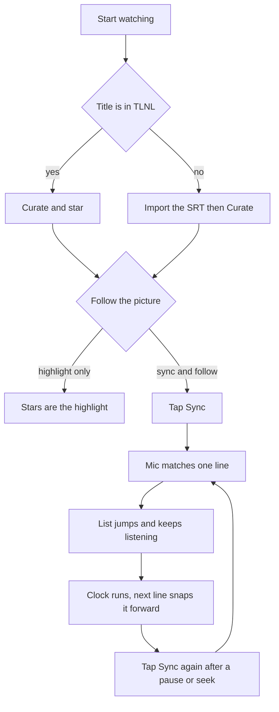
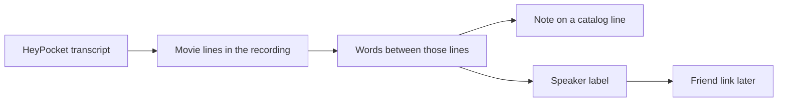

# w2g

Watch together done right. Highlight a line in Textline, keep the list on the picture, and keep what the room said on that line.

2.7 is the highlight and the sync. 2.8 is the note. The roadmap indexes both. The steps an agent runs are [watch-highlight](../.cursor/skills/watch-highlight/SKILL.md) and [line-notes](../.cursor/skills/line-notes/SKILL.md).

Opened on a live watch of The Odyssey (1997).

## While watching

| Situation | What you do | Where it lands |
| --- | --- | --- |
| The film is already in TLNL | Open it and star lines in Curate | A star in production D1 when you are signed in on the live site |
| A new film | Drop the SRT, import, then Curate | The same star, on line numbers from that import. The live site shows the film after a Pages deploy |
| Highlighting outside the app | Highlight in Readwise. It syncs to Obsidian | `content:vault-title`, then a dry-run `content:stars-push` for that title. The note stays on the seed. It is not a D1 column |

Do the import once. Later stars use those line numbers.

## Sync

In Curate. Tap Sync. The mic stays on. The first matching line is a rough start: the list jumps there and the clock runs from the moment that phrase was heard. The live line sits at the bottom of the list, so the lines just said stay on screen. Scrolling the list parks it there, and the highlight keeps moving. Current line, at the top and the bottom of the list, jumps back and follows again. A clean line locks as soon as it is said, and the clock moves to the end of that cue so the next line is the one on screen. If the speech runs on before the first lock, every 5 seconds the words already heard are checked again, against lines long enough to be a place in the movie. That stretch starts at 5 seconds and grows until one of those lines is close. The clock starts from when those words were heard, so a late lock catches up. While Sync is still searching, the words it hears stay on screen. After a lock, that line hides. The mic keeps listening. Every 5 seconds the words just heard are matched again, against lines a little behind the clock and a little ahead of it, and a hit pulls the highlight back onto the picture. Not this drops the rough start and keeps listening. Stop holds the list. Tap Sync again after a pause, a seek, or a bad lock. The movie file is not required. The transcript timings are the clock.

## Notes

A line note is the room on one quote: a joke, a life story, another movie. Quote parallels stay analogy packs, a curated tie between lines. Friends are a later link for a person. The words can be stored before anyone is linked.

There is no notes table. Curate shows a typed note on any line and stores it in this browser. The note shows the person in this watch. For now that is you. Adding other people to the session, once, comes later. A watch session file can still hold a note. The app does not read that file.

| Path | What you do | Now |
| --- | --- | --- |
| Type it | Write the note on the line | In Curate, this browser only. Your icon sits beside it |
| Readwise | Highlight online. Vault-import after it reaches Obsidian | The star path works. The note stays on `stars-seed.json` |
| HeyPocket after the watch | Drop the transcript. Confirm the mapping | Procedure only. The Odyssey recording with Matty Ice waits on the transcript |
| The Sync mic | Keep the mic stretch as the note on the line it locked | Needs Sync. Still confirmed by you |

An utterance that matches a catalog line is a lock, not a note. The words between locks are the room, attached to the lock they follow. `movieMsAtStart` is the fallback when the movie is missing from the transcript. The raw utterance stays. A cleaned line waits until you accept it. The audio stays in HeyPocket.

Speaker labels start as `Speaker 1`. Rename in place. Link a label to a friend when you decide they are the same person.

A later note may name another title's line. That pointer is not an analogy pack.

## Still later

- Summarize a stretch of chatter into one note, after you accept the short line.
- Play the recording in the app.
